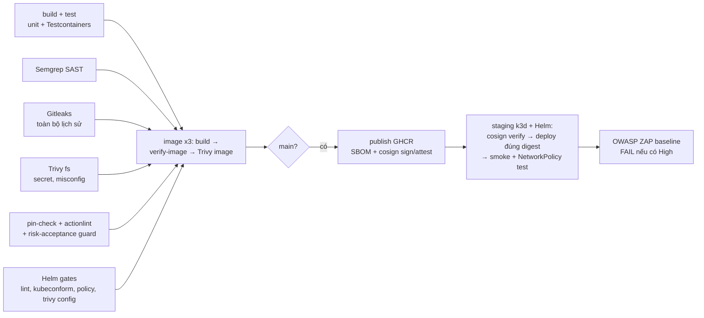
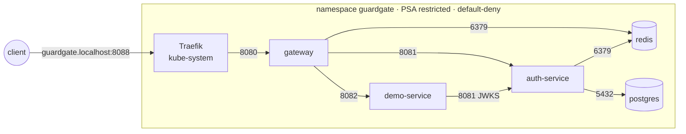

# GuardGate

API Gateway + Auth Service với pipeline DevSecOps hoàn chỉnh (Java 21, Spring Boot 3).

> README đầy đủ (sơ đồ kiến trúc, bảng OWASP Top 10) sẽ được viết ở giai đoạn 7.

## Cấu trúc

```
guardgate/
├── pom.xml                  # Parent POM (multi-module, Spring Boot + Spring Cloud BOM)
├── auth-service/            # :8081 – đăng ký, đăng nhập, JWT, refresh rotation, RBAC, lockout, audit
├── gateway/                 # :8080 – Spring Cloud Gateway, xác thực JWT, rate limit
├── demo-service/            # :8082 – service mẫu (public / user / admin)
├── infra/postgres/init/     # Script tạo DB + user riêng cho auth-service
├── charts/guardgate/        # Helm chart (PSA restricted, NetworkPolicy, Secret theo component)
├── scripts/k8s/             # up.sh / down.sh (k3d), create-secrets.sh
├── docker-compose.yml       # Postgres + Redis cho môi trường local
└── .env.example             # Mẫu biến môi trường (copy thành .env)
```

## Chạy local

Yêu cầu: JDK 21+, Docker Desktop, OpenSSL (có sẵn trong Git Bash).

```bash
cp .env.example .env
# Đổi toàn bộ mật khẩu, rồi sinh khoá ký JWT và dán vào JWT_PRIVATE_KEY:
openssl genpkey -algorithm RSA -pkeyopt rsa_keygen_bits:2048 | openssl pkcs8 -topk8 -nocrypt -outform DER | openssl base64 -A

docker compose up -d --wait                       # Postgres + Redis
./mvnw test                                       # unit test (không cần Docker)
./mvnw verify                                     # + integration test (Testcontainers, cần Docker)
```

Trên Windows PowerShell dùng `.\mvnw.cmd` và đặt tham số `-D...` trong dấu nháy kép.
Nếu cổng 5432 đã bị Postgres cài sẵn trên máy chiếm, đặt `POSTGRES_PORT=5433` trong `.env`.

### Chạy bằng Docker (cả hệ thống)

```bash
docker compose up -d --build --wait     # Postgres, Redis, auth-service, demo-service, gateway
bash scripts/smoke-test.sh              # kiểm tra end-to-end qua http://localhost:8080
docker compose down                     # dừng (giữ dữ liệu); thêm -v để xoá cả volume
```

Mỗi service chạy trong container **non-root** (uid 10001), filesystem **chỉ đọc** (chỉ `/tmp` ghi được, trên RAM),
bỏ mọi Linux capability, cấm leo quyền và giới hạn RAM. Về **ứng dụng**, chỉ gateway publish cổng ra host
(`127.0.0.1:8080`); auth-service và demo-service chỉ truy cập được trong mạng Docker. File compose mặc định vẫn
publish Postgres/Redis trên `127.0.0.1` để dev chạy app bằng Maven; staging (`docker-compose.staging.yml`) bỏ hẳn
hai cổng này. Mỗi container chỉ nhận đúng biến môi trường nó cần: gateway không giữ khoá ký JWT hay mật khẩu DB
(kiểm tra bởi `scripts/tests/compose-secrets.test.sh`). Kiểm tra một image:
`bash scripts/verify-image.sh guardgate/guardgate-gateway:dev`.

### Chạy từng service bằng Maven (phát triển)

Mỗi service một terminal; profile `local` đọc `.env` ở thư mục gốc:

```bash
./mvnw -pl auth-service spring-boot:run -Dspring-boot.run.profiles=local   # :8081
./mvnw -pl demo-service spring-boot:run -Dspring-boot.run.profiles=local   # :8082
./mvnw -pl gateway      spring-boot:run -Dspring-boot.run.profiles=local   # :8080 (điểm vào duy nhất)
bash scripts/smoke-test.sh                                                 # kiểm tra end-to-end qua gateway
```

Smoke test kiểm tra: đăng ký, đăng nhập, phân quyền USER/ADMIN, thu hồi token khi logout, rate limit đăng nhập
(lần thứ 11 trong một phút bị 429) và việc giả mạo `X-Forwarded-For` không có tác dụng. Rate limit tính theo phút,
nên nếu chạy lại script ngay lập tức thì bước đăng ký có thể bị 429: chờ khoảng 1 phút rồi chạy lại.

**Đăng nhập GitHub:** tạo OAuth App với callback **qua gateway** `http://localhost:8080/login/oauth2/code/github`,
điền `GITHUB_CLIENT_ID/SECRET` vào `.env`, chạy auth-service với `-Dspring-boot.run.profiles=local,github`
rồi mở `http://localhost:8080/oauth2/authorization/github`.

## Gateway (:8080)

| Route | Đích | Quyền tại gateway |
|---|---|---|
| `POST /api/auth/{register,login,refresh}` | auth-service | public, rate limit ≈10 request/phút/IP |
| `/api/auth/**` khác (logout) | auth-service | cần token |
| `/api/users/**` | auth-service | cần token |
| `/api/admin/**` | auth-service | ADMIN |
| `/oauth2/**`, `/login/oauth2/**` | auth-service | public (luồng GitHub) |
| `GET /api/demo/public` | demo-service | public |
| `/api/demo/admin/**` | demo-service | ADMIN |
| `/api/demo/**` khác | demo-service | cần token |
| mọi path khác | không có route | 401 (không token) / 404 |

Gateway xác thực JWT (JWKS của auth-service + denylist Redis), rate limit bằng token bucket trong Redis
(theo IP, theo IP cho các endpoint đăng nhập, theo user), thay `X-Forwarded-*` của client bằng giá trị thật,
áp CORS allow-list, giới hạn body 1 MB, timeout 5 giây, và trả mọi lỗi dạng `application/problem+json`.
Các service phía sau vẫn tự xác thực lại JWT (defense in depth).

## CI/CD DevSecOps

[](https://github.com/LukastGeorge/guardgate/actions/workflows/ci.yml)



| Cổng chặn | Công cụ | FAIL khi |
|---|---|---|
| Test | JUnit, Mockito, Testcontainers | bất kỳ test nào đỏ |
| SAST | Semgrep (`p/java`, `p/owasp-top-ten`, `p/secrets`) | finding mức ERROR |
| Secret | Gitleaks (toàn bộ lịch sử git) | có leak, **hoặc** quét 0 commit / git lỗi |
| Secret + cấu hình | Trivy fs (offline) | HIGH/CRITICAL có bản vá (dependency bắc cầu được kiểm ở bước image) |
| Image | `verify-image.sh` + Trivy image | chạy root, có secret/source, thiếu healthcheck; CVE HIGH/CRITICAL (quét lại đúng digest được publish, trước khi ký) |
| Chuỗi cung ứng pipeline | pin-check, actionlint | action không pin theo SHA, workflow lỗi |
| Helm chart | helm lint, kubeconform `-strict`, `helm-policy.test.sh`, Trivy config | schema sai, container thiếu hardening, Secret trong manifest hoặc sai pod, thiếu NetworkPolicy, misconfig HIGH/CRITICAL |
| Staging | cosign verify, smoke test, `k8s-netpol.test.sh` | image chưa ký hoặc khác digest, lớp bảo vệ nào đó hỏng trên cluster thật |
| DAST | OWASP ZAP baseline | alert High, **hoặc** thiếu report |

Kết quả Semgrep và Trivy fs được đẩy lên tab **Security → Code scanning** (SARIF).

**Chạy đúng bộ quét của CI trên máy trước khi push:** `bash scripts/security-scan.sh`

**Xác minh image đã được ký bởi pipeline của repo này** (keyless, Sigstore):

```bash
cosign verify ghcr.io/lukastgeorge/guardgate-gateway:latest \
  --certificate-identity "https://github.com/LukastGeorge/guardgate/.github/workflows/ci.yml@refs/heads/main" \
  --certificate-oidc-issuer https://token.actions.githubusercontent.com
cosign verify-attestation --type cyclonedx ... # SBOM CycloneDX đính kèm image (cùng tham số identity)
```

**Chấp nhận rủi ro có thời hạn:** `.trivyignore.yaml` liệt kê 3 CVE của Spring Framework 6.2 chỉ được vá ở 7.x
(Spring Boot 4), kèm lý do không khai thác được và ngày hết hạn `2027-02-26`. `scripts/check-risk-acceptance.sh`
làm CI fail nếu code bắt đầu dùng tính năng bị ảnh hưởng (XsltView, SSE, RouterFunction).

**Bài học chuỗi cung ứng:** đầu năm 2026 Trivy bị tấn công supply chain (release bị xoá, tag của `trivy-action`
bị trỏ sang mã đánh cắp credential). Vì vậy mọi action được pin theo **commit SHA**, mọi image công cụ pin theo
**digest**, và commit `trivy-action` → `setup-trivy` → script cài đặt đều đã được kiểm tra chữ ký và ngày tạo.

## Kubernetes (Helm + k3d)

Chart `charts/guardgate` deploy toàn hệ thống lên Kubernetes, **an toàn theo mặc định**:



Mỗi mũi tên là một rule NetworkPolicy. Mọi kết nối khác, kể cả ra Internet, đều bị chặn.

| Lớp bảo vệ | Cách làm | Kiểm chứng |
|---|---|---|
| Pod Security | namespace `enforce: restricted`; mọi container non-root, root FS chỉ đọc, `drop: [ALL]`, seccomp `RuntimeDefault`, không mount token ServiceAccount | `helm-policy.test.sh`; cluster thật: 0 vi phạm PSA |
| Mạng | `default-deny` + DNS; mỗi workload một policy sinh từ **đồ thị gọi nhau** (ingress/egress không thể lệch nhau) | `k8s-netpol.test.sh`: 26 kiểm tra từ pod thật + pod "người lạ" |
| Secret (D21) | mỗi component một Secret, tạo từ `.env` bằng `scripts/k8s/create-secrets.sh`; chart **không chứa secret nào**; gateway/demo không thấy khoá ký JWT | allow-list Secret theo workload trong `helm-policy.test.sh` |
| Điểm vào | một Ingress duy nhất, chỉ trỏ tới gateway | `helm-policy.test.sh` |
| Image | tag = SHA commit (cấm `latest`); CI ghim thêm **digest đã cosign verify** | `workflow-policy.test.sh` |

### Chạy trên máy (k3d)

Cần Docker, `kubectl`, `helm` và [k3d](https://k3d.io) (đặt binary vào `.tools/` hoặc trong PATH, nhớ kiểm tra SHA256
theo file `checksums.txt` của release).

```bash
bash scripts/k8s/up.sh            # cluster + build/import image + Secret từ .env + helm --wait (~3 phút)
bash scripts/smoke-test.sh http://guardgate.localhost:8088
bash scripts/tests/k8s-netpol.test.sh
export KUBECONFIG=.tools/kubeconfig   # kubeconfig riêng, không đụng ~/.kube/config
kubectl -n guardgate get pods
bash scripts/k8s/down.sh          # xoá cluster (kèm dữ liệu)
```

**Kiểm tra tĩnh, không cần cluster:** `bash scripts/tests/helm-policy.test.sh` chạy helm lint, kubeconform `-strict` và các
luật bảo mật bằng jq. CI còn chạy thêm `trivy config`.

**Điều rút ra khi deploy thật:**
- K8s tự bơm biến `AUTH_SERVICE_PORT=tcp://…`, trùng tên với biến cấu hình của app → đặt `enableServiceLinks: false`.
- K8s không có `depends_on` → thêm init container `wait-for-deps`. Nhờ đó lần dựng cluster mới không có restart nào.
- Traefik mặc định bỏ `X-Forwarded-For` mà client tự gửi lên. Thêm vào `GATEWAY_TRUSTED_PROXIES=1` của gateway, ta có
  hai lớp chống giả IP. Smoke test chứng minh điều này qua Ingress.

**Production:** thay Postgres/Redis trong chart bằng dịch vụ managed (D17), và quản lý Secret bằng External Secrets hoặc
Sealed Secrets thay cho `create-secrets.sh`.

## Auth Service API

| Method | Path | Quyền | Mô tả |
|---|---|---|---|
| POST | `/api/auth/register` | public | Đăng ký (`email`, `password` 12–64 ký tự) |
| POST | `/api/auth/login` | public | Trả `accessToken` (JWT RS256, 15 phút) + `refreshToken` (7 ngày) |
| POST | `/api/auth/refresh` | public | Đổi refresh token lấy cặp token mới (rotation) |
| POST | `/api/auth/logout` | USER | Thu hồi access token (Redis) + family của refresh token |
| GET | `/api/users/me` | USER | Thông tin tài khoản hiện tại |
| GET | `/api/admin/audit-logs` | ADMIN | Audit log, lọc `?eventType=`, phân trang `?page=&size=` |
| POST | `/api/admin/users/{id}/unlock` | ADMIN | Mở khoá tài khoản |
| GET | `/.well-known/jwks.json` | public | Public key để gateway xác thực JWT |
| GET | `/oauth2/authorization/github` | public | Đăng nhập GitHub (profile `github`) |

Mọi lỗi trả về dạng [RFC 9457 Problem Details](https://www.rfc-editor.org/rfc/rfc9457) (`application/problem+json`).

```bash
curl -X POST localhost:8081/api/auth/register -H 'Content-Type: application/json' \
     -d '{"email":"alice@example.com","password":"Correct-Horse-Battery-1"}'
curl -X POST localhost:8081/api/auth/login -H 'Content-Type: application/json' \
     -d '{"email":"alice@example.com","password":"Correct-Horse-Battery-1"}'
curl localhost:8081/api/users/me -H "Authorization: Bearer <accessToken>"
```
