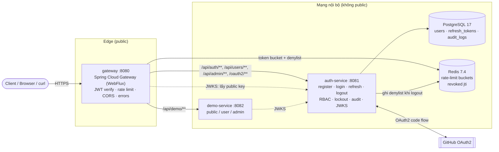
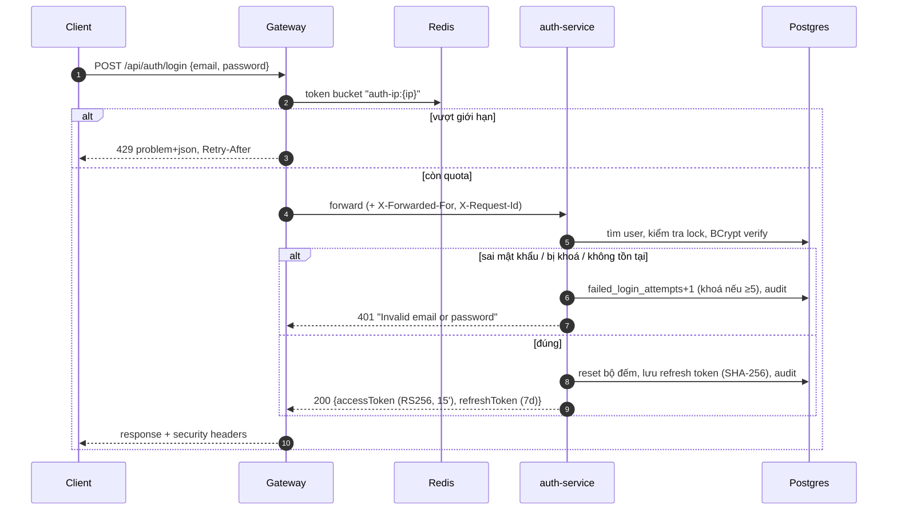
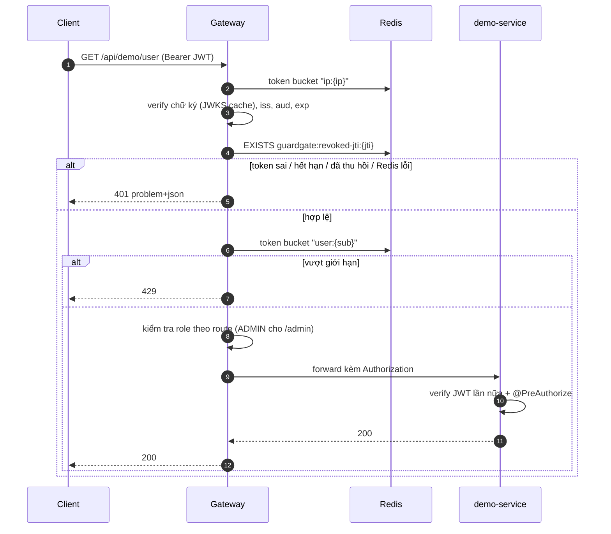
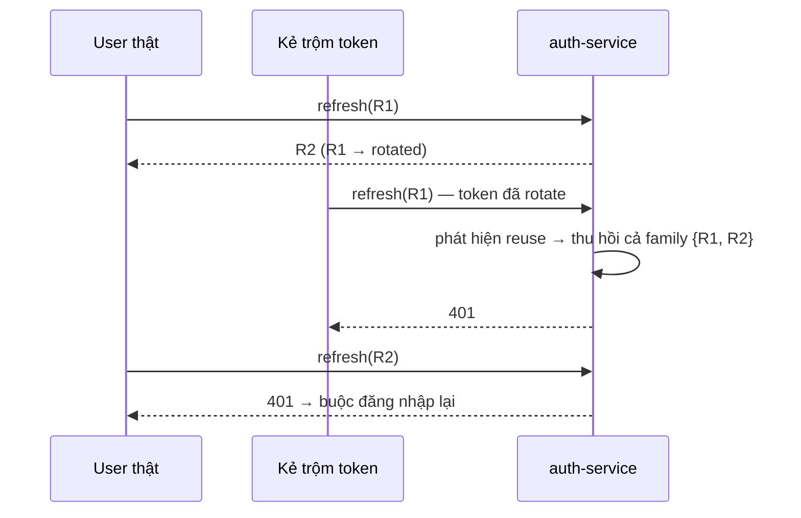
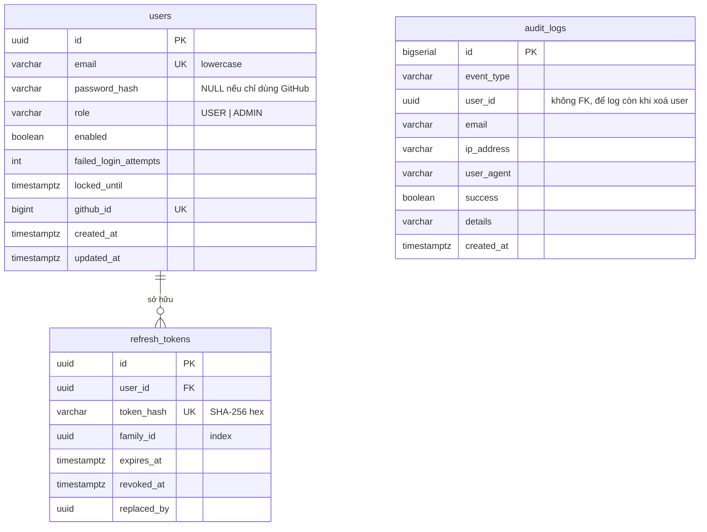
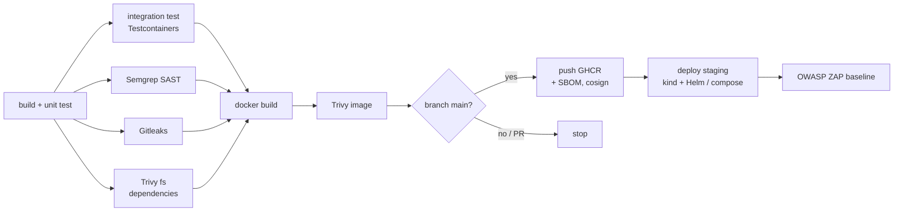
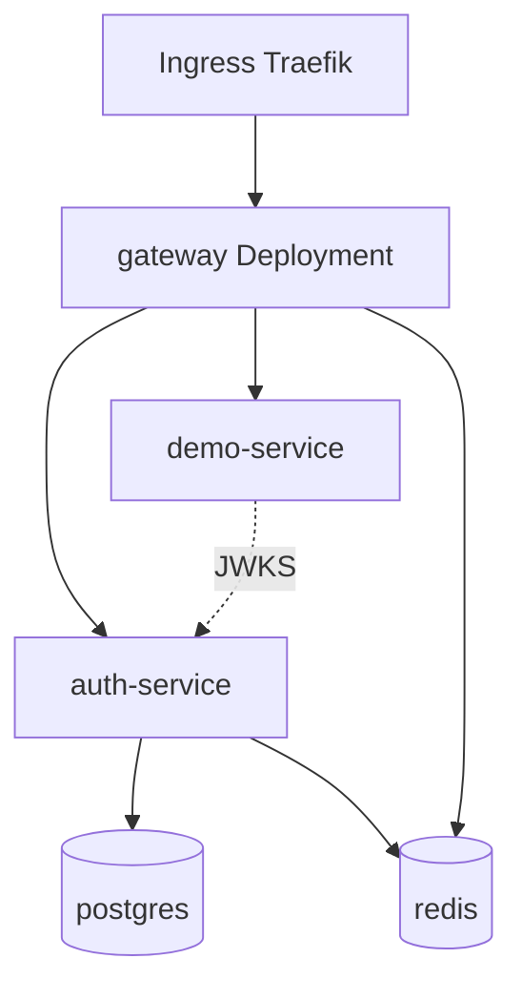

# GuardGate — Đặc tả & Thiết kế tổng thể

| | |
|---|---|
| **Trạng thái** | Bản nháp, chờ thảo luận (giai đoạn 1–2 đã code, giai đoạn 3–7 chưa) |
| **Ngày** | 2026-11-27 |
| **Plan triển khai** | Mỗi giai đoạn một file trong `docs/superpowers/plans/`. Hiện có: giai đoạn 1, 2 (as-built), 3 |

Quy trình cho mọi giai đoạn: **đặc tả → thiết kế → sơ đồ → bàn luận → code**. Không viết code cho giai đoạn nào khi phần đặc tả của nó chưa được duyệt.

---

## 1. Mục tiêu

Xây một hệ thống xác thực và cổng API cho portfolio DevSecOps, chứng minh được ba điều:

1. **Bảo mật ứng dụng**: xác thực/phân quyền đúng chuẩn, chống brute-force, thu hồi token, xử lý lỗi không lộ thông tin, tuân theo OWASP Top 10.
2. **Bảo mật chuỗi cung ứng và pipeline**: mọi thay đổi đi qua SAST, quét secret, quét dependency/image, DAST; lỗ hổng HIGH/CRITICAL làm pipeline FAIL.
3. **Vận hành**: container non-root, deploy Kubernetes bằng Helm, giám sát các sự kiện bảo mật (request bị chặn, đăng nhập thất bại).

**Ngoài phạm vi:** frontend UI, xác minh email/quên mật khẩu, MFA, multi-tenant, môi trường production thật.

## 2. Kiến trúc tổng thể

**Nguyên tắc:**
- **Chỉ gateway được public.** auth-service, demo-service, Postgres và Redis chỉ truy cập được trong mạng nội bộ (compose network ở giai đoạn 4, NetworkPolicy ở giai đoạn 5).
- **Defense in depth:** gateway xác thực JWT, và downstream service **cũng** xác thực lại chữ ký JWT (không tin header do gateway thêm vào).
- **Khoá bất đối xứng:** chỉ auth-service giữ private key. Các service khác lấy public key qua `/.well-known/jwks.json`.

## 3. Luồng chính

### 3.1 Đăng nhập qua gateway

### 3.2 Request đã xác thực

### 3.3 Refresh token rotation và phát hiện dùng lại (đã có ở giai đoạn 2)

## 4. Quyết định thiết kế

Trạng thái: ✅ đã chốt · 🟡 **đề xuất, cần bàn**.

| # | Quyết định | Lý do / Đánh đổi | |
|---|---|---|---|
| D1 | JWT RS256, access token 15 phút, refresh token opaque 7 ngày lưu SHA-256 | Service khác chỉ cần public key; refresh token opaque thì server thu hồi được | ✅ |
| D2 | Refresh rotation + thu hồi cả family khi phát hiện reuse | Phát hiện token bị đánh cắp (theo OAuth 2.0 Security BCP) | ✅ |
| D3 | Logout ghi `jti` vào Redis với TTL bằng thời gian sống còn lại của token | Thu hồi JWT stateless; key tự hết hạn | ✅ |
| D4 | Khoá 15 phút sau 5 lần sai; cùng một thông báo lỗi cho mọi trường hợp | Chống brute-force + chống dò tìm tài khoản | ✅ |
| D5 | Dùng Spring Cloud Gateway **WebFlux** (không dùng bản MVC) | Có sẵn RedisRateLimiter reactive; non-blocking hợp cho edge | 🟡 |
| D6 | Gateway kiểm tra denylist: **fail-closed** (Redis lỗi → 401) | Token đã logout không được lọt qua; đánh đổi: Redis chết thì mọi request cần auth đều lỗi | 🟡 |
| D7 | Rate limit: **fail-open** (Redis lỗi → cho qua, có log + metric) | Ưu tiên tính sẵn sàng; lockout ở auth-service (Postgres) vẫn chặn brute-force | 🟡 |
| D8 | Rate limit 3 tầng (token bucket): **auth-ip** 10 req/phút/IP cho login/register/refresh; **ip** burst 40, nạp 20/s cho mọi request; **user** burst 20, nạp 10/s theo `sub` | Login cần chặt nhất; theo user để chống một tài khoản bị lạm dụng từ nhiều IP | 🟡 |
| D9 | IP client: mặc định dùng remote address; chỉ tin `X-Forwarded-For` khi đặt `GATEWAY_TRUSTED_PROXIES=n` (số hop) | Chống giả mạo XFF để né rate limit; trên K8s đặt 1 (ingress) | 🟡 |
| D10 | Downstream xác thực lại JWT (chữ ký, iss, aud), **không** kiểm tra denylist | Defense in depth mà không thêm phụ thuộc Redis vào mọi service; denylist chỉ ở edge và auth-service | 🟡 |
| D11 | Không tạo module dùng chung (`common`); chấp nhận trùng lặp nhỏ (ProblemDetail writer, role converter) | Gateway là reactive còn service khác là servlet, API khác nhau; YAGNI | 🟡 |
| D12 | CORS chỉ cấu hình ở gateway, allow-list từ `CORS_ALLOWED_ORIGINS`, không cho credentials (token đi trong header) | Một chỗ duy nhất kiểm soát; service phía sau không trả header CORS | 🟡 |
| D13 | Timeout tới downstream: connect 2s, response 5s; body tối đa 1 MB | Chống treo kết nối và payload quá lớn (DoS) | 🟡 |
| D14 | Image runtime: `eclipse-temurin:21-jre-alpine`, user uid 10001, Spring Boot layered jar | Có shell/wget cho healthcheck và debug; distroless an toàn hơn nhưng khó học/debug | 🟡 |
| D15 | Staging cho CI: cluster **kind** dựng tạm trong runner GitHub Actions; deploy bằng Helm (giai đoạn 5); trước khi có Helm thì dùng docker compose | Miễn phí, tái lập được, không cần server thật | 🟡 |
| D16 | K8s local: **k3d** (k3s chạy trong Docker) trên Windows | Nhẹ hơn minikube, có sẵn Traefik ingress như k3s thật | 🟡 |
| D17 | Postgres/Redis trên K8s: tự viết StatefulSet tối giản trong chart (chỉ cho dev/staging) | Bitnami đã đổi chính sách image (2025); production nên dùng dịch vụ managed | 🟡 |
| D18 | Supply chain bổ sung: pin GitHub Actions theo SHA, Dependabot, SBOM CycloneDX, ký image bằng cosign (keyless) | Xu hướng SLSA; cosign và SBOM là tuỳ chọn, có thể bỏ nếu muốn gọn | 🟡 |
| D19 | Metrics: `/actuator/prometheus` mở trên **cổng quản trị riêng** (9090 nội bộ), không route qua gateway | Không lộ metrics ra Internet | 🟡 |

## 5. Yêu cầu chung (áp dụng mọi giai đoạn)

- Java 21, Spring Boot **3.5.12** (bản vá CVE-2026-22731/22733), Spring Cloud 2025.0.x, Maven multi-module, `./mvnw`.
- Không hardcode secret; mọi secret lấy từ biến môi trường. `.env` không bao giờ được commit.
- Mọi lỗi trả về `application/problem+json` (RFC 9457); không lộ stack trace, tên class hay câu SQL.
- Security headers trên mọi response: `X-Content-Type-Options: nosniff`, `X-Frame-Options: DENY`, `Content-Security-Policy: default-src 'none'; frame-ancestors 'none'`, `Referrer-Policy: no-referrer`, `Cache-Control: no-store`, HSTS (qua HTTPS).
- Actuator public chỉ có `health` và `info`.
- Unit test `*Test` (Surefire, không cần Docker); integration test `*IT` (Failsafe + Testcontainers).
- Commit nhỏ, mỗi task một commit; CI phải xanh trước khi merge (từ giai đoạn 4).

## 6. Đặc tả từng giai đoạn

### Giai đoạn 1: Khởi tạo ✅ Đã xong
Plan: `docs/superpowers/plans/2026-11-27-phase1-bootstrap.md`

**Yêu cầu**
- R1.1 Maven multi-module: parent `guardgate-parent` + 3 module `auth-service`, `gateway`, `demo-service`; Java 21; Spring Boot 3.5.x, Spring Cloud 2025.0.x qua BOM.
- R1.2 Build tự dừng nếu JDK < 21, Maven < 3.9, hoặc có xung đột version dependency (enforcer `dependencyConvergence`).
- R1.3 Mỗi module khởi động được, chỉ mở Actuator `health` và `info`, không bao giờ trả stack trace.
- R1.4 docker-compose: PostgreSQL 17 và Redis 7.4, pin version image, có healthcheck, port **chỉ bind `127.0.0.1`**, `no-new-privileges`, dữ liệu lưu trên named volume.
- R1.5 Secret chỉ lấy từ `.env` (không commit); compose dừng ngay nếu thiếu biến (`${VAR:?}`).
- R1.6 Least privilege trên DB: auth-service dùng user `auth_service` riêng, sở hữu DB `guardgate_auth`, không phải superuser. Xác thực bằng SCRAM-SHA-256.
- R1.7 Redis bắt buộc mật khẩu; vô hiệu hoá `FLUSHALL`, `FLUSHDB`, `CONFIG`, `DEBUG`.
- R1.8 Maven Wrapper; line ending LF cho script (`.gitattributes`); `.gitignore` chặn `.env`, khoá và keystore.

**Nghiệm thu:** `./mvnw verify` xanh; `docker compose up -d --wait` có 2 container healthy; user `auth_service` không tạo được database mới; `redis-cli` không có mật khẩu thì bị `NOAUTH`; `git ls-files` không chứa `.env`.

### Giai đoạn 2: auth-service ✅ Đã xong, còn hạng mục hardening
Plan: `docs/superpowers/plans/2026-11-27-phase2-auth-service.md`

**Yêu cầu chức năng**
- R2.1 Đăng ký bằng email + mật khẩu. Email được chuẩn hoá (trim, lowercase) và là duy nhất. Mật khẩu 12–64 ký tự, không được trùng email. Luôn tạo với role `USER`, mọi trường thừa (ví dụ `role`) bị bỏ qua.
- R2.2 Đăng nhập trả `accessToken` (JWT RS256, 15 phút) + `refreshToken` (opaque 256-bit, 7 ngày) + `tokenType=Bearer` + `expiresIn`.
- R2.3 Refresh: đổi refresh token lấy cặp mới (rotation). Dùng lại token đã rotate thì thu hồi **cả family** và ghi audit `REFRESH_TOKEN_REUSE_DETECTED`.
- R2.4 Logout (cần access token): thu hồi access token qua denylist Redis; nếu gửi kèm refresh token thì thu hồi family của nó (chỉ khi token thuộc đúng user).
- R2.5 RBAC: `USER`, `ADMIN`. `/api/admin/**` chỉ dành cho ADMIN (rule theo URL + `@PreAuthorize`). ADMIN đầu tiên tạo từ biến môi trường `BOOTSTRAP_ADMIN_*`.
- R2.6 Lockout: sau 5 lần sai liên tiếp thì khoá 15 phút. Khi đang khoá thì từ chối kể cả mật khẩu đúng. ADMIN mở khoá được. Bộ đếm cập nhật nguyên tử (không race condition).
- R2.7 Audit log cho mọi sự kiện xác thực (bảng `audit_logs` + log `AUDIT`), ghi trong transaction riêng nên còn lại kể cả khi request lỗi. ADMIN xem được, có lọc và phân trang.
- R2.8 JWKS public tại `/.well-known/jwks.json`, chỉ chứa thành phần public của khoá.
- R2.9 Đăng nhập GitHub (profile `github`): chỉ chấp nhận email chính **đã xác minh**; không tự liên kết vào tài khoản local đã có cùng email; thành công thì trả cặp token giống login.

**Yêu cầu bảo mật**
- S2.1 BCrypt cost 12 qua `DelegatingPasswordEncoder` (đổi được thuật toán về sau); tự nâng cấp hash khi user đăng nhập.
- S2.2 Mọi lỗi xác thực trả cùng một thông báo `Invalid email or password`; email không tồn tại vẫn chạy BCrypt với hash giả (chống timing attack).
- S2.3 Decoder chỉ chấp nhận RS256 và kiểm tra `iss`, `aud`, `exp`, `nbf`, `jti`, denylist (fail-closed).
- S2.4 Khoá RSA ≥ 2048 bit, đọc từ `JWT_PRIVATE_KEY`; thông báo lỗi không bao giờ chứa nội dung khoá.
- S2.5 Refresh token lưu SHA-256; `SELECT … FOR UPDATE` khi rotate.
- S2.6 Lỗi dạng problem+json; lỗi validation không lặp lại giá trị đã gửi; lỗi 500 chỉ trả `errorId`.
- S2.7 API stateless (không session, không CSRF vì không dùng cookie); chỉ luồng OAuth2 có session ngắn hạn.
- S2.8 `toString()` của DTO/entity không in mật khẩu, hash hay token; audit log được làm sạch ký tự điều khiển (chống log injection).
- S2.9 Chỉ tin `X-Forwarded-For` khi request đến từ proxy nội bộ (`forward-headers-strategy: native`).

**Mô hình dữ liệu** (Flyway `V1__init_schema.sql`)

**API**: xem bảng ở README (mục "Auth Service API").

**Nghiệm thu:** 21 unit test + 19 integration test xanh; smoke test bằng curl trên Postgres/Redis thật xác nhận: đăng ký, đăng nhập, payload JWT không chứa email, USER gọi API admin bị 403, rotation, reuse bị 401, logout làm token cũ bị 401, validation 400 không lộ input, đủ security headers.

**Hardening (đưa vào Task 1 của plan giai đoạn 3)**, phát hiện khi rà soát bằng skill security-reviewer:

| ID | Mức | Vấn đề | Xử lý |
|---|---|---|---|
| H1 | HIGH | Spring Boot 3.5.7: CVE-2026-22731, CVE-2026-22733 (Actuator auth bypass) | Nâng lên 3.5.12 |
| H2 | HIGH | pgjdbc 42.7.8: CVE-2026-42198 (DoS), CVE-2026-54291 (SCRAM downgrade) | Ghim 42.7.12 |
| H3 | MEDIUM | Mật khẩu ≤ 64 **ký tự** nhưng có thể > 72 **byte** UTF-8 (BCrypt giới hạn 72 byte); emoji/tiếng Việt có dấu có thể gây lỗi 500 | Validate độ dài theo byte UTF-8 ≤ 72 |
| H4 | LOW | Chưa rà soát thủ công đầy đủ phần OAuth2 khi đứng sau gateway (redirect-uri) | Kiểm tra trong smoke test giai đoạn 3 |
| H5 | MEDIUM | Chưa có test **đồng thời** cho lockout (20 request sai song song phải khoá đúng 1 lần) và cho rotation (2 request refresh song song cùng một token thì đúng 1 cái thành công) | Thêm IT chạy song song |
| H6 | LOW | Luồng GitHub OAuth2 chưa có test tự động (chỉ test khi profile tắt) | Unit test `OAuth2AccountService` + `GitHubOAuth2UserService` (mock `RestClient`) |

### Giai đoạn 3: Gateway + rate limiting + demo-service 🟡 Chờ duyệt
**Gateway (:8080)**
- Route: `/api/auth/**`, `/api/users/**`, `/api/admin/**`, `/oauth2/**`, `/login/oauth2/**` → auth-service; `/api/demo/**` → demo-service. Không route `/.well-known/**` và `/actuator/**` của downstream ra ngoài.
- Bảo mật: public gồm `POST /api/auth/{register,login,refresh}`, `GET /api/demo/public`, OAuth2 và health; `/api/admin/**` và `/api/demo/admin` cần ADMIN; còn lại cần đăng nhập. Xác thực JWT qua JWKS URI + iss + aud + exp + denylist (D6).
- Rate limit theo D7, D8, D9. Khi bị chặn trả 429 kèm `Retry-After` và `X-RateLimit-Remaining`.
- CORS (D12), timeout và giới hạn body (D13), sinh/lan truyền `X-Request-Id` (chỉ chấp nhận `[A-Za-z0-9-]{1,64}`).
- Lỗi chuẩn: 401/403/404/413/429/503 (downstream chết)/504 (timeout), tất cả là problem+json.
- Metric `guardgate_gateway_blocked_requests_total{reason}` với reason ∈ `rate_limit_auth_ip`, `rate_limit_ip`, `rate_limit_user` (giai đoạn 6 dùng để vẽ dashboard).

**demo-service (:8082)**: resource server. `GET /api/demo/public` (ai cũng gọi được), `/api/demo/user` (USER/ADMIN, trả `subject`), `/api/demo/admin` (ADMIN).

**Nghiệm thu:** chạy 3 service + compose, rồi chạy `scripts/smoke-test.sh` qua gateway. Script phải xác nhận: đăng ký → đăng nhập → gọi demo user 200, demo admin 403, admin 200 → logout làm token cũ bị 401 → đăng nhập liên tục bị 429 → không có token bị 401 → header giả `X-Forwarded-For` không né được rate limit.

### Giai đoạn 4: Docker + CI/CD DevSecOps 🟡 Chờ duyệt
- Dockerfile multi-stage cho từng service: build bằng `maven:3.9-eclipse-temurin-21`, runtime theo D14, `USER 10001`, `HEALTHCHECK`, layered jar, không có source hay Maven trong image.
- `docker-compose.yml` đầy đủ: thêm 3 service, chỉ gateway publish port, `read_only: true`, `cap_drop: [ALL]`, `no-new-privileges`.
- GitHub Actions:

- **Cổng chặn:** Semgrep có kết quả mức ERROR, Gitleaks phát hiện bất kỳ leak nào, Trivy có HIGH/CRITICAL (`--exit-code 1 --ignore-unfixed`), ZAP có cảnh báo mức High → FAIL. Upload SARIF lên tab Security của GitHub.
- Quyền workflow tối thiểu (`permissions:` theo từng job), action pin theo SHA (D18), Dependabot cho Maven, Docker và Actions.

### Giai đoạn 5: Helm + Kubernetes 🟡 Chờ duyệt
- Chart `charts/guardgate`: 3 Deployment + Service, Postgres/Redis (D17), Ingress (Traefik) **chỉ trỏ tới gateway**.
- Pod security: `runAsNonRoot`, `readOnlyRootFilesystem`, `allowPrivilegeEscalation: false`, `capabilities.drop: [ALL]`, `seccompProfile: RuntimeDefault`, namespace gắn nhãn Pod Security Admission `restricted`.
- NetworkPolicy mặc định deny-all, chỉ mở: ingress→gateway, gateway→auth/demo/redis, auth→postgres/redis, demo→auth (JWKS).
- Secret: chart dùng `existingSecret`; secret được tạo từ `.env` bằng script (không commit); ghi chú hướng production (External Secrets / Sealed Secrets).
- Liveness/readiness probe từ Actuator, resource requests/limits, `GATEWAY_TRUSTED_PROXIES=1`.
- **Nghiệm thu:** `helm lint`, `helm template | kubeconform`, Trivy config scan không có HIGH; deploy lên k3d (D16) và smoke test qua ingress đều pass.

### Giai đoạn 6: Giám sát 🟡 Chờ duyệt
- `micrometer-registry-prometheus`; metrics ở cổng quản trị (D19).
- Metric nghiệp vụ: `guardgate_gateway_blocked_requests_total{reason}`, `guardgate_auth_login_failures_total{reason}` (reason ∈ `bad_credentials`, `unknown_account`, `locked`, `disabled`), `guardgate_auth_accounts_locked_total`, `guardgate_auth_refresh_reuse_total`.
- Prometheus + Grafana trong docker-compose (profile `monitoring`); trên K8s cài kube-prometheus-stack (tuỳ chọn).
- Dashboard được provision sẵn: request bị chặn theo lý do, đăng nhập thất bại theo thời gian, tài khoản bị khoá, phân bố mã lỗi 4xx/5xx, latency p95.
- Alert rule: > 20 lần đăng nhập thất bại/phút; có bất kỳ sự kiện refresh reuse nào; tỉ lệ 5xx > 5%.

### Giai đoạn 7: README & tài liệu 🟡 Chờ duyệt
README hoàn chỉnh: sơ đồ (tái sử dụng mục 2–3), hướng dẫn chạy (compose, k3d), mô tả pipeline, **bảng OWASP Top 10 (2021)** ánh xạ tới file/test cụ thể (bản nháp ở mục 7), các hạn chế đã biết.

## 7. Bản nháp ánh xạ OWASP Top 10 (2021)

| OWASP | Biện pháp | Ở đâu |
|---|---|---|
| A01 Broken Access Control | Deny-by-default, RBAC theo URL + `@PreAuthorize`, lấy user từ `sub` (chống IDOR), chống mass assignment | auth `SecurityConfig`, `AdminController`, `UserController`; gateway (GĐ3) |
| A02 Cryptographic Failures | BCrypt(12), RS256 ≥ 2048 bit, refresh token lưu SHA-256, SCRAM-SHA-256 cho Postgres, HSTS | `CoreConfig`, `RsaKeyLoader`, `RefreshTokenService`, compose |
| A03 Injection | JPA tham số hoá, Bean Validation, chống log injection, psql `:'var'` | `AuditService.sanitize`, `01-create-auth-db.sh` |
| A04 Insecure Design | Lockout, rotation + reuse detection, rate limit, threat model trong file này | `LoginAttemptService`, gateway (GĐ3) |
| A05 Security Misconfiguration | Không trả stack trace, Actuator tối thiểu, security headers, container non-root | `application.yml`, `GlobalExceptionHandler`, Dockerfile (GĐ4), Helm (GĐ5) |
| A06 Vulnerable Components | Trivy, Dependabot, enforcer dependencyConvergence | CI (GĐ4), `pom.xml` |
| A07 Identification & Auth Failures | Thông báo lỗi chung, chống timing attack, policy mật khẩu NIST, thu hồi token | `AuthService`, `AccessTokenDenylist` |
| A08 Software & Data Integrity | Không tự liên kết OAuth2 (chống pre-account takeover), pin action theo SHA, cosign | `OAuth2AccountService`, CI (GĐ4) |
| A09 Logging & Monitoring Failures | Audit log, log AUDIT tách riêng, metrics + alert | `AuditService`, GĐ6 |
| A10 SSRF | Gateway chỉ route tới URI cố định từ cấu hình; JWKS URI cố định | gateway config (GĐ3) |

## 8. Câu hỏi cần bàn trước khi code giai đoạn 3

1. **D6/D7:** đồng ý denylist fail-closed và rate limit fail-open?
2. **D8:** các con số rate limit (login 10/phút/IP; IP burst 40; user burst 20) có hợp lý cho demo không?
3. **D10:** downstream chỉ verify chữ ký mà không kiểm tra denylist. Chấp nhận được, hay muốn demo-service cũng kiểm tra Redis?
4. **D11:** chấp nhận trùng lặp nhỏ, hay muốn tạo module `guardgate-common`?
5. Các quyết định của giai đoạn 4–6 (D14–D19) có thể bàn sau, nhưng nếu bạn đã có ý kiến (ví dụ dùng minikube thay vì k3d, distroless thay vì alpine) thì cho mình biết sớm.
